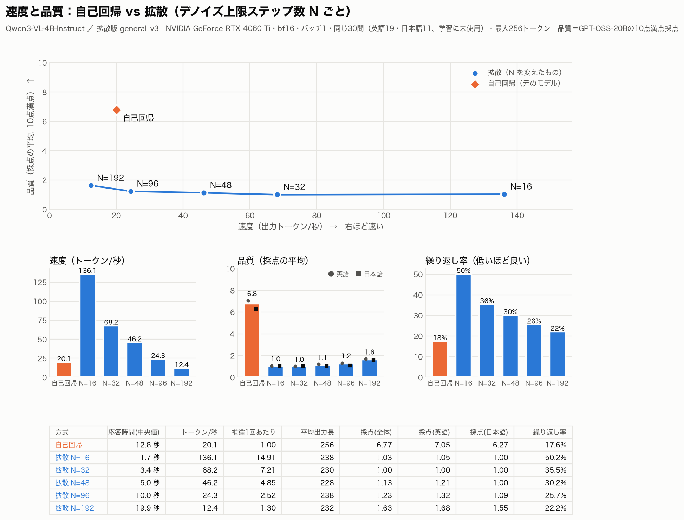
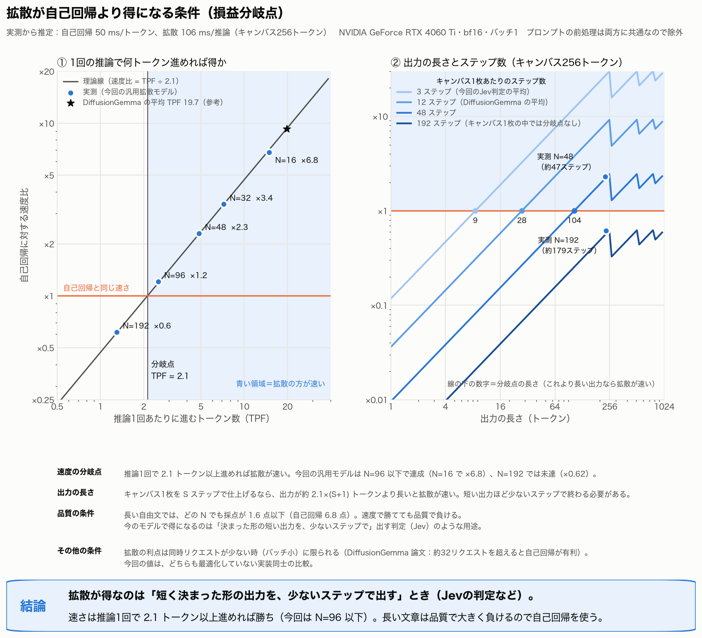

# 過去の実験結果（開発記録用）

最終2モデル以外の評価を含む旧レポートを保存。発表用の結果は Diffusion-Jev_report.md を参照。

# Diffusion-Jev 拡散化レポート

2026年10月24日

## 概要

**結論：拡散化は、出力の各部分を同時に決める課題で自己回帰に勝てました。** 数独では精度も速度も大きく上回り、質問の多い判定では同等の精度で約2倍速く、確率もより正確でした。答えが1つだけの判定、長い自由文、日本語では、自己回帰の方が良い結果でした。

| 課題 | 拡散 vs 自己回帰 | 勝ったのは |
| --- | --- | --- |
| 数独（200問） | 完全正解 65.0% vs 4.0%、応答 0.50秒 vs 8.9秒 | **拡散** |
| 質問の多い判定（1文に16問、穴埋め形式） | 正解率 96.3% vs 95.5%、応答 0.55秒 vs 1.13秒 | **速度は拡散**、精度は同等 |
| 判定の確率の正確さ（1,800問） | ECE 0.007 vs 0.021 | **拡散** |
| 判定の正解率（1,800問） | 90.5% vs 91.3% | 自己回帰（僅差） |
| 画像の判定（600問） | 86.7% vs 90.0%（元のモデル 88.0%） | 自己回帰 |
| 長い自由文（30問、10点満点） | 採点 1.6点以下 vs 6.8点 | 自己回帰 |

自由文以外は、同じデータ・同じ学習量でSFTした自己回帰モデルとの比較です（自由文は、拡散化していない元のモデルとの比較）。画像は一度も学習していませんが、拡散化後も元のモデルから−1.3ポイントにとどまりました。

やったことは、Qwen3-VL-4B-Instruct（自己回帰モデル）を、DiffusionGemma論文（arXiv:2608.00146）の手順で離散拡散モデルに作り変え、その上にJev風の型付き判定（Choice / Noul / Score）を学習させたことです。学習と評価はすべて、手元のRTX 4060 Ti（16GB）1枚で行いました。

## 背景と、具体的に行ったこと

出発点は、DiffusionGemmaが構造化出力を少ない反復で完成できるなら、型付きの複数判定を確率付きで返すJevと相性がよいのではないか、という仮説です。最終的には、回答生成を明確な穴埋め問題に変え、値の位置だけを壊して復元する学習を行いました。

[手法・データ・実際の入出力の詳細](Diffusion-Jev_methods.md)に、拡散化3節、Jev化4節、保存済み実測例をまとめました。理論、投入データ、設定、比較条件を段階ごとに確認できます。

## 構成（論文の手順との対応）

既存の自己回帰モデルを初期値にし、「汎用の拡散化（§4）→ 用途別の追加学習（§8）」の2段階で作りました。

| 論文の記述 | 今回の実装 |
| --- | --- |
| §3：重みを共有した因果エンコーダと双方向デコーダ。文脈はKVキャッシュ経由で参照 | 同じ。任意のHFモデルで、キャンバス内だけを双方向にする注意マスクで実現 |
| 式6：自己条件付け z = FFW(p̂₀E) | 同じ（FFWは新規に追加） |
| Algorithm 1：エントロピー上限付きサンプリング、温度アニーリング（0.8→0.4）、適応停止 | 同じ。上限ステップ数Nだけ、48ではなく192を標準にした |
| §3.1：ブロック自己回帰（完成したキャンバスを文脈に追加） | 同じ |
| §4：マルチノミアル拡散（t\~U\[0,1\]、確率tで一様トークンに置換）、式11 | 同じ。キャンバス256トークン×2枚 |
| §8・式13：下流SFT（エンコーダ損失＋デコーダ損失、50%の自己条件付け、LoRA） | 同じ。設定はTable 7のPubMedQAを基本に、判定向けにキャンバス64トークン×1枚 |
| §5：SD·RL（ステップ数を減らす蒸留と強化学習） | 未実施（損失の式が論文にない） |

**バックボーン**はQwen3-VL-4B-Instruct（4.4B、動画対応、Apache-2.0）です。2026年の新しい軽量モデル（Qwen3.5/3.8系、LFM、MiniCPM-V 4.7など）は線形注意や畳み込みとの混成で、マスクによる双方向化ができないため除外しました。

**学習データ**

- 汎用の拡散化：元のモデルに自分で答えさせた回答（英語1.2万件、日本語1.5万件）と、GPT-OSS-20Bの回答（英語1.2万件）
- Jev化：公開データ9種類を変換した判定4.3万件、GPT-OSS-20Bが作った判定（自己一致フィルター後）1.1万件、GPT-OSS-120Bが作った判定約250件

画像評価の解釈には留保があります。画像付き600問には、文章や知識だけでも解ける問題が含まれます。画像を外した同一問題との対照は未実施なので、この正解率だけで画像理解の寄与を確定できません。具体例は写真中の対象認識と、図中の距離を読む問題に差し替えました（[詳細](Diffusion-Jev_methods.md)）。

## 評価に使ったベンチマーク

「判定が当たるか」「確率を信用できるか」「文章が書けるか」「画像を読めるか」「速いか」の5つを、それぞれ別のベンチマークで測っています。学習と評価に同じ問題は使っていません。

**判定の精度（テキスト、計1,800問、9種類×200問）**

| ベンチマーク | どういうものか | ここで測るもの・意図 |
| --- | --- | --- |
| BoolQ | 文章を読んで、はい/いいえで答える | 読解にもとづくNoul（はい/いいえ）の判定 |
| MultiNLI | 2文の関係（含意・中立・矛盾）を答える | Choice1問＋Noul2問を同じ状態に付け、答え同士の整合性を見る |
| SST-2 | 映画レビューの感情（肯定/否定） | 基本的な分類。関連する2問を同時に答えさせる |
| AG News | ニュースの分野（4択） | 分野のChoiceと、「これはスポーツか」などのNoulが矛盾しないか |
| GoEmotions | コメントに含まれる感情（28種類、複数あり） | 1つの文に4つのNoul。複数の答えを同時に出す練習 |
| Civil Comments | コメントの有害度と、侮辱・脅迫・卑猥かどうか | Score（3段階）＋Noul3問。コンテンツ審査型の判定 |
| CommonsenseQA | 常識の5択問題 | 知識を使うChoice。純粋な精度の比較 |
| ARC | 小中学校の理科の選択問題 | 同上 |
| Amazonレビュー（日本語） | 商品レビューの星の数と好意的かどうか | 日本語の判定。Jevが「日本語は苦手」と公表している点への対策 |

**そのほかのベンチマーク**

| ベンチマーク | どういうものか | ここで測るもの・意図 |
| --- | --- | --- |
| HH-RLHF harmless（人手ラベル2,000件） | 会話への2つの応答のうち、人が「無害」と選んだ方 | RLCD論文のTable 5と同じ測り方。最初のRLCD版の評価に使った |
| ScienceQA（画像付き300問） | 図や地図を読む理科の選択問題 | 画像を学習していない拡散化モデルに、画像を読む力が残っているか |
| A-OKVQA（300問） | 写真を見て常識で答える4択 | 同上（写真の理解） |
| 自由文の採点（30問） | UltraChatの英語19問＋日本語指示データ11問に256トークンで答え、GPT-OSS-20Bが10点満点で採点 | 長い文章の品質。「拡散化で文章力がどれだけ残るか」 |
| 速度の実測（同じ30問） | 同じGPU・同じ質問で、応答時間と推論1回あたりのトークン数（TPF）を測る | DiffusionGemma論文§3.4・§6と同じ指標で、拡散が速くなる条件を調べる |

**指標の意味**

- **正解率**：質問ごとに、いちばん確率の高い答えが正解だった割合。
- **全問正解率**：1行に付いた質問が全部正解だった割合。複数の答えが整合しているかを見る。
- **ECE（較正誤差）**：「確信度90%」と言った答えが実際に90%当たるか。Jevのように確率を返す用途では、正解率と同じくらい大事。小さいほど良い。
- **NLL**：正解にどれだけ確率を割り当てたか。自信過剰な間違いを重く罰する。小さいほど良い。
- **first読み出し**：完全にノイズの状態での最初の予測から確率を読む方式。収束後の確率は0か1に偏るため、こちらを採用した。

## スケジュールと各段階の結果

10月20日から24日までの5日間、RTX 4060 Ti 1枚で進めました。学習と評価はキューを組み、夜間も自動で回しています。時間はすべて日本時間です。

| 日時 | 作業 | 結果 |
| --- | --- | --- |
| 10/20 昼 | 論文2本とJevの調査、設計、実装とテスト | 学習経路と推論経路の出力が一致（テスト11件） |
| 10/20 昼 | バックボーン選定 | Qwen3-VL-4B（画像・動画対応、全層が通常の注意） |
| 10/20 18:35–18:50 | RLCDで選好ペア9,306組を生成（vLLM） | 1万件で約15分 |
| 10/20 19:00–21:28 | RLCD版のSFTとHH評価 | 一致率52.6〜53.7%（元のモデル57.3%）。失敗 |
| 10/20 21:47 | 原因の切り分け（同じ重みを自己回帰モードで評価） | 自己回帰でも51.0% → 拡散ではなくデータが原因 |
| 10/20 22:20 – 10/21 13:09 | 汎用拡散 v1（自己蒸留1.2万件）。短い回答しか残らない不具合を直して学習し直し | 学習なしで判定60.1%、正しいJSON 74% |
| 10/21 13:09–18:33 | Jev化 v2（判定4.3万件）と評価 | **87.5%**（元のモデル83.5%）、ECE 0.034、0.27秒 |
| 10/21 18:07–18:18 | 速度の実測（N=48） | 拡散46.2トークン/秒 vs 自己回帰18.1 |
| 10/21 19:24 – 10/22 04:52 | GPT-OSS-20B（手元）とGroqの120Bで蒸留 | 判定1.1万件、回答1.2万件 |
| 10/22 09:18–14:44 | 20Bの判定ラベルを120Bで検証、自己一致フィルター | 一致率74.3% → 93.5% |
| 10/22 14:44–22:34 | 汎用拡散 v2（2.4万件） | N=192で英語の説明が書ける。日本語は崩れる |
| 10/22 23:51 – 10/23 06:35 | 日本語1.5万件を自己蒸留して汎用拡散 v3 | 日本語で2文の説明が書けるように |
| 10/23 08:48–09:24 | 速度と品質のNスイープ（16〜192）、損益分岐点 | 分岐点TPF 2.1。品質は全Nで自己回帰に大差で負け |
| 10/23 09:38–18:38 | Jev化 v4と、同じデータで学習した自己回帰（対照実験） | 87.4% vs **88.1%**。判定では自己回帰が上 |
| 10/23 18:39–19:07 | 画像600問で段階ごとの評価 | 元88.0% → 汎用拡散24.7% → Jev化86.5% |
| 10/23 20:06–20:43 | 質問数の多い判定（1〜16問） | 16問で拡散が2.2倍速いが、全問正解1% vs 46% |
| 10/23 20:45 – 10/24 05:32 | 数独：拡散と自己回帰を同じデータでSFT、評価 | **65.0% vs 4.0%、0.50秒 vs 8.9秒** |
| 10/24 05:48–10:00 | 簡略版SD·RL（数独、30回） | 65.5% → 67.5% → 55.5%。効果なし |
| 10/24 12:40–20:59 | 穴埋め形式のJev化（判定＋多問6.5万件）と評価 | 16問で0.55秒、判定90.5%、ECE 0.007 |
| 10/24 21:00–22:47 | 自己回帰を同じデータで学習し直して公平に比較 | 正解率は自己回帰が僅差で上、速度と較正は拡散 |
| 10/24 夜 | トークナイザの分析 | Qwenは漢字・かなの15.6%を分割（Gemma 4は0.1%） |

**分かったこと**

- 拡散化と用途別の学習を一度にやると、文章を書く力ごと崩れる（RLCD版）。段階を分けるのが大事。
- RLCD版の精度低下は拡散のせいではなかった。同じ重みを自己回帰モードで動かしても 51.0% に落ちており、学習データの問題だった。
- 確率の読み出しは、収束後の最終ステップではなく、完全にノイズの状態での最初の予測（first）を使うと、正解率も較正も最も良かった。
- GPT-OSS-20Bが作った判定ラベルは4問に1問が間違いだった。思考を深くして解き直させ、一致したものだけ残すと、GPT-OSS-120Bとの一致率が74.3%から93.5%に上がった。

**RLCDは効かず、最終的なモデルには使っていません。** RLCDで作った選好ペア約9,300組で学習すると、HHの人手ラベルとの一致率は52.6〜53.7%で、元のモデル（57.3%）より下がりました。温度調整後のNLLは0.69で、当てずっぽうと同じです。RLCD論文の選好モデル（7B、52.4%）とはほぼ一致しており、再現はできています。ただ、「露骨な対比」から覚えた判断は、微妙な差を見分ける判定には役立ちませんでした。その後は、公開データ9種類とGPT-OSSで作った判定データに切り替えています。

## 速度と品質

**速さの面では、拡散は「少ないステップで仕上がる出力」で得をします。** 速さは、推論1回で2.1トークン以上進めば自己回帰に勝ちます（今回はN=96以下）。長い文章は品質で大きく負けるので、自己回帰を使うべきです。

分岐点の2.1は、拡散の推論1回（106ms、キャンバス256トークン）が自己回帰の1トークン（50ms）の約2.1倍重いことから来ています。キャンバス1枚をSステップで仕上げるなら、出力が約2.1×(S+1)トークンより長いと拡散が速くなります。Jevの判定（約15トークン、3ステップ前後）は、この条件を満たします。

## 対照実験と画像の評価（10/23夜）

精度だけで見ると、判定用途でも拡散化しない方が良い結果でした。どちらも同じ判定データ5.5万件、6,000ステップで学習しています。

**テキストの判定（1,800問）**

| モデル | 正解率 | ECE | NLL | 応答時間 |
| --- | --- | --- | --- | --- |
| 元のモデル（学習なし・自己回帰） | 83.5% | 0.142 | 1.29 | 0.15秒 |
| Jev化 v4（拡散、first読み出し） | 87.4% | 0.016 | 0.34 | 0.26秒 |
| 対照実験（自己回帰＋SFT） | **88.1%** | 0.019 | **0.30** | **0.15秒** |

**画像の判定（ScienceQA 300問＋A-OKVQA 300問）**

| 段階 | 正解率 | ScienceQA | A-OKVQA | 正しいJSON | 応答時間 |
| --- | --- | --- | --- | --- | --- |
| 未学習（元のモデル） | 88.0% | 91.0% | 85.0% | — | 0.19秒 |
| 拡散化（汎用 v3） | 24.7% | 24.3% | 25.0% | 32% | 1.93秒 |
| Jev化 v4（拡散） | 86.5% | 85.7% | 80.3% | 100% | 0.34秒 |
| 自己回帰＋SFT | **89.5%** | 92.7% | 86.3% | — | 0.19秒 |

- 前回「拡散の強み」に見えた複数質問での全問正解率の差は、学習していない元のモデルと比べていたために出ていた。対照実験と比べると自己回帰が上（Civil Comments 72.0% vs 58.5%）。
- 画像は一度も学習していないが、Jev化モデルは元のモデルから1.5ポイントしか落ちなかった。画像を読む力は拡散化後も大部分残っている。
- 汎用拡散v3の低い点数は、答えの間違いではなく出力形式の崩れが主な原因。数字を引用符で囲む・かっこを閉じないなどの崩れを許して答えを読むと、24.7%が57.0%になる。

## 拡散が有利な課題：数独と、質問数の多い判定（10/24）

**数独では、拡散が精度・速度ともに大きく勝ちました（完全正解65.0% vs 4.0%、0.50秒 vs 8.9秒）。** 出力の各部分がお互いに強く制約し合う課題では、盤面全体を同時に決められる拡散が有利です。DiffusionGemma論文§8の数独の例（学習前0%→LoRAで84%）と同じ傾向です。

**数独（学習に使っていない200問、空きマス40〜60個）**。学習はどちらも2万問、8,000ステップ、論文Table 7の数独レシピ（LoRA rank 8）。

| モデル | 完全に解けた割合 | 空きマスの正解率 | 応答時間 | 推論回数 |
| --- | --- | --- | --- | --- |
| 学習なし：元のモデル（自己回帰） | 0% | 13.8% | 8.9秒 | 162回 |
| 学習なし：汎用拡散 v3 | 0% | 0.9% | 10.2秒 | 91回 |
| 数独で学習：自己回帰＋SFT | 4.0% | 60.1% | 8.9秒 | 162回 |
| 数独で学習：拡散＋SFT | **65.0%** | **93.9%** | **0.50秒** | **4.3回** |

**質問数の多い判定（GoEmotions、同じコメントに質問をk個、各100件）**。速度は拡散が勝ち、精度は自己回帰が勝ちました。

| 質問数 | 拡散（Jev化 v4）正解率 / 全問正解 / 応答時間 | 自己回帰でJSONを書く 正解率 / 全問正解 / 応答時間 |
| --- | --- | --- |
| 1 | 60.0% / 60% / 0.26秒 | 82.0% / 82% / 0.38秒 |
| 4 | 80.2% / 40% / 0.48秒 | 88.3% / 70% / 1.38秒 |
| 16 | 78.7% / 1% / 2.48秒 | 94.3% / 46% / 5.44秒 |

自己回帰は質問が増えるほど時間が比例して伸び、16問で拡散が約2.2倍速い。ただし拡散のJev化モデルは1行最大5問程度でしか学習しておらず、質問が多いと全問正解率が崩れる。

**簡略版SD·RL（数独、30回繰り返し）**：先生（N=192）が1問4本を生成→正解寄りの1本を選ぶ→強いノイズを重点に蒸留、という論文§5の説明に沿った実装。200問・N=48で、開始前65.5%→5回目67.5%→15回目64.5%→30回目55.5%。序盤の改善は誤差の範囲内で、続けると悪化した。数独はもともと4〜5回の推論で解けるため、ステップ数を減らす余地がなかった。次は自由文で、元のモデルから離れすぎない正則化を足して試す。

## 穴埋め形式のJev化と公平な比較（10/24夜）

**判定を明確な穴埋め問題として学習し、複数の値をまとめて復元する形式にすると、形式の崩れがなくなり、質問が多いほど速くなりました。** DiffusionGemmaのマルチノミアル拡散では、枠のトークンを毎ステップ戻すだけでこの穴埋めができます。学習では値の欄だけにノイズを入れ、デコーダの復元損失を欄だけで取りました（エンコーダの次トークン損失は別に加算）。最終版は128トークン×1キャンバスです。データは判定5.5万件に、1文に8〜16問付けた行1万件を加えました。自己回帰は、同じデータで学習した上で、同じ枠を前から順に埋めさせています（質問の数だけ推論が必要）。

穴埋め化と同時に多問データも追加しているため、改善を穴埋め単独の効果とは断定できません。正解率・確率はfirst読み出し、応答時間は反復停止までの計測です。両方式の判定SFTデータ・ステップ数を揃えていますが、拡散側だけに先行する汎用拡散化があり、全工程の学習計算量は同一ではありません。

**質問数ごとの判定（GoEmotions、各100件）**

| 質問数 | 拡散・穴埋め（正解率 / 全問正解 / 応答時間 / 推論回数） | 自己回帰（同じデータで学習） |
| --- | --- | --- |
| 1 | 84.0% / 84% / 0.21秒 / 2.2回 | 87.0% / 87% / 0.06秒 / 1回 |
| 4 | 90.5% / 74% / 0.33秒 / 3.5回 | 87.3% / 69% / 0.27秒 / 4回 |
| 8 | 91.0% / 60% / 0.40秒 / 4.3回 | 92.6% / 65% / 0.53秒 / 8回 |
| 16 | 96.3% / 54% / 0.55秒 / 5.7回 | 95.5% / 60% / 1.13秒 / 16回 |

**判定1,800問と画像600問**

| モデル | 判定の正解率 | ECE | NLL | 画像の正解率 |
| --- | --- | --- | --- | --- |
| 拡散（JSONを丸ごと生成、v4） | 87.4% | 0.016 | 0.34 | 86.5% |
| 拡散・穴埋め | 90.5% | **0.007** | **0.25** | 86.7% |
| 自己回帰（同じデータで学習、同じ枠を順に埋める） | **91.3%** | 0.021 | 0.31 | **90.0%** |

- 質問が8個を超えると拡散の方が速くなり、16問で約2倍。精度はほぼ同等で、全問正解率は自己回帰がやや上。
- 拡散だけが多問データで学習していた段階では「精度も拡散が上」に見えたが、自己回帰にも同じデータを学習させると差は消えた。
- 確率の正確さ（ECE・NLL）は拡散が一貫して良い。確率を返すJev型の用途では強みになる。
- データ別では、ARC・GoEmotions・MultiNLIで拡散が上、Civil Comments・BoolQ・CommonsenseQA・Amazon日本語・SST-2で自己回帰が上。

## 日本語とトークナイザ

**日本語が弱い大きな原因の一つは、Qwenのトークナイザが普通の漢字を複数の断片に分けることだと考えられます。** 自己回帰は断片を順に書くので崩れませんが、拡散は断片を同時にばらばらに決めるので、組み合わせが食い違うと文字化けします。自由文の先頭に何度も出た「▯散言語モデル」の▯が、この崩れ方です。

|  | Qwen3-VL（今回） | Gemma 4 |
| --- | --- | --- |
| 語彙数 | 15.2万 | 26.2万 |
| 1文字あたりのトークン数 | 0.64 | 0.56 |
| 文章中のトークンのうち、文字の断片の割合 | 8.7% | 0.3% |
| 出てくる漢字・かな2,355種類のうち、複数トークンに分かれるもの | 368種類（15.6%、例：単・効・値・処） | 3種類（0.1%） |

日本語の自己蒸留データ1,500件（約114万文字）で測定。日本語の判定（Amazonレビュー）も、拡散79.8%に対し自己回帰81.2%でした。対策は、①断片が正しい文字にならない箇所を埋め直させるサンプラーの工夫（学習不要）、②Qwenの語彙に日本語を追加、③トークナイザの良いバックボーンへの交換、の3つです。

## DiffusionGemma論文と合致した点

規模は桁違いに小さいものの、論文が報告している傾向はほとんどそのまま再現しました。

| 論文の報告 | 今回の観測 |
| --- | --- |
| §4・図6：SFT前のモデルはデノイズできない | 拡散化しただけのモデルは、48ステップ回しても意味のない文字列のまま |
| §5・付録B：SFTだけのモデルを少ないステップ数（N=48）で動かすと、繰り返しループに陥る | N=48で「blue blue blue…」のような繰り返しが出た |
| §5・図10：SFT直後のモデルは、Nを192まで増やすほど性能が上がる | N=192にすると繰り返しが減り、英語で3文の説明を書けた。採点もNとともに上昇（1.03→1.63） |
| §7・表3：拡散化すると元の自己回帰モデルより精度が下がる（例：AIME 88.3%→69.1%） | 長い自由文の採点が6.8点→1.6点以下。論文より差は大きいが、向きは同じ |
| §9.3：JSONなど決まった形の出力は2〜3ステップで収束する | 判定のJSONは平均2.3〜3.3ステップで収束。括弧やキー名が先に確定し、答えの値が最後に決まる |
| §3.3：適応停止で、簡単なタスクほど少ないステップで終わる | 判定は数ステップ、自由文は数十〜百数十ステップ。学習が進むと同じ文章も少ないステップで確定（159→78ステップ） |
| §6：速さは「推論1回あたりのトークン数（TPF）÷ 推論1回の重さ」で決まる | 実測5点が「速度比 = TPF ÷ 2.1」の線にほぼ乗った |
| §6：拡散の推論1回はキャンバス全体を処理するので重い（自己回帰の約3.2倍） | 拡散の推論1回は自己回帰1トークンの約2.1倍（106ms vs 50ms） |
| §3.5：拡散化した重みは、自己回帰モードでも動く | 同じ重みを自己回帰モードで評価でき、拡散かデータかの切り分けに使えた |

## 論文と違う点・限界

品質の差が論文より大きい主な理由は、学習量とSD·RLの有無だと考えています。

- **学習量**：論文は数千億トークン規模。今回は合計で数千万トークン程度で、桁が約4つ違う。
- **SD·RL（§5）は簡略版だけ試した（数独で効果なし）**：損失の式が論文に書かれていないため。そのため「少ないステップで高品質」が実現できず、品質を取るとN=192で自己回帰より遅くなる。論文のTPFは約20、今回はN=192で1.3。
- **LoRAでの学習**：論文の第1段階は全パラメータ。今回は16GBのGPUに収めるためrank 64のLoRA。
- **モデルの大きさ**：論文は25.2BのMoE（3.8B稼働）、今回は4.4Bの密モデル。
- **上限ステップ数**：論文の推奨はN=48だが、これはSD·RL後の値。SFTだけの今回はN=192を標準にした。
- **論文にない追加**：判定の確率の読み出し、自己条件付けFFWのゼロ初期化、画像・動画のプレースホルダーをキャンバスに出さない処理。
- **測定の限界**：速度はどちらも最適化していない実装同士の比較。品質は30問をGPT-OSS-20B 1モデルで採点したもの。判定の正解率の比較は、まだ「学習なしの自己回帰」が相手。

## 今後の候補

拡散の強み「同時に決められる」を活かせる方向で、次の3つを候補にしています。

1. **日本語の改善**：まず学習不要のサンプラーの工夫で文字化けを減らす。根本的には、日本語のトークナイザが良く、動画も扱える同じくらいの大きさのモデル（候補はGemma 4 E4B）で、今回の手順をやり直す。E4Bは層ごとの埋め込みのため、自己条件付けの足し込み方に工夫が必要。
2. **SD·RLを自由文で試す**：元のモデルから離れすぎない正則化を足して、成否の基準を決めて1回だけ試す。成功の基準は、N=48でN=192と同じ品質（採点1.6点以上、繰り返し率22%以下）を出せること。

本物のJevとの比較は行いません。Jevは判定専用に作られたモデルで、汎用モデルを拡散化した今回のモデルとは性質が異なるためです。
