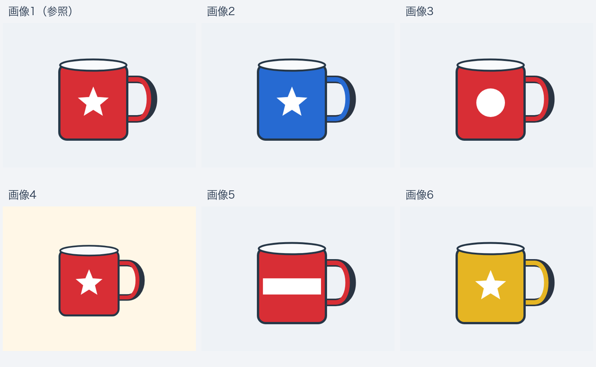

# 参照画像と候補画像を渡して照合してみる

2026年10月25日。最終の拡散Jev `runs/jev_infill` へ複数画像を順番付きで渡し、14件と追加の切り分け9件、計23回の呼び出しを行った。追加学習やモデル改修はしていない。

**複数画像を渡すこと自体はできた。今回の試用では2枚ずつの照合が使いやすく、似た物の6枚一括選択は不安定だった。**

## 入力方法

既存の `schema.messages` は、`media` リストの画像を順番どおり同じユーザーメッセージに入れ、その後へ状態・質問のテキストを置く。1枚目を参照、2枚目以降を候補として質問できる。6画像の例ではprocessorの `image_grid_thw` が6行、入力1,658トークンになっており、画像を1枚へ落として処理していたわけではない。

```json
{
  "state": "画像は指定順です。1枚目が参照画像です。見えない場合は不明を選んでください。",
  "media": [
    {"type": "image", "path": "reference.png"},
    {"type": "image", "path": "candidate.png"}
  ],
  "questions": [
    {
      "type": "choice",
      "id": "match",
      "question": "1枚目と2枚目の物は、色と模様も含めて同じ見た目ですか？",
      "options": ["一致", "不一致", "見えないため不明"]
    }
  ]
}
```

これは入力形式の説明用例。実際の試用では英語の状態・問い・候補を使った。2〜6枚目から選ぶ場合もChoiceに `Image 2`〜`Image 6`、`none`、`cannot determine` を並べられる。APIの答えは選択肢番号なので、**候補番号と画像番号をプログラムで対応付ける必要がある**。例えば4番目の選択肢が `Image 5` なら、返り値 `4` は画像5を意味する。

## 何を「同じ」とするか

今回の図版では「同じ種類」と「同じ見た目」を別に聞いた。同じ見た目は、形・本体色・前面のマークが一致すること、と明示した。背景や表示位置、縮尺が違っても同じ見た目と扱う。

同じ種類のマグカップでも、色やマークが違えば同じ見た目ではない。また、同じ見た目であっても**同じ物理個体であることまでは確認できない**。同一個体の照合には、固有の傷・シリアル番号・別角度の写真などを使った追加の試用が必要。

## 2枚の比較

色・模様を指定できるマグカップのSVG図版を作り、ブラウザで描画した。モデルへ正解ラベルは渡していない。

| 参照と2枚目の関係 | 最終拡散Jevの実際の答え |
| --- | --- |
| 全く同じ図版 | 同じ種類98.3%、同じ見た目93.4% |
| 同じマグを縮小し、位置と背景を変更 | 同じ種類98.8%、同じ見た目49.1%（不一致43.3%と近い） |
| 赤い星マグ対、青い星マグ | 同じ種類99.0%、同じ見た目ではない74.2% |
| 赤い星マグ対、赤い丸マークのマグ | 同じ種類98.4%、同じ見た目ではない62.8% |
| 前面マークを覆って見えなくした | 同じ見た目ではない51.2%。マークを確認できないので、不明を選んでほしかった |

種類と色・模様の違いを分けて答えることはできたが、同じ見た目でも変形・背景変更で確率が低くなり、隠れた特徴では保留できなかった。

## 「2枚目の中に参照物があるか」

1枚目に赤い星マグ、2枚目に3つのマグを並べた場面を渡した。

| 2枚目の場面 | 実際の返答 |
| --- | --- |
| 赤い星マグを含む | ある63.9% |
| 青い星・赤い帯・黄色い星だけで、参照物を含まない | **ある45.5%と誤判定** |
| 青い星・赤い帯・赤い丸だけで、似ているが一致しない | **ある44.4%と誤判定** |

単独の物同士の比較より、場面の中から対象を探す条件は難しかった。今回の少数例では「ある」を返しやすく、見つからなかったときの扱いが気になる。

## 6枚から同じものを選ぶ

下の画像は閲覧用に6枚を並べたもの。**モデルへは、この合成画像ではなく6つの別画像を指定順で渡した。** 画像1が参照で、画像4が背景・縮尺の異なる一致候補。



| 渡し方 | 実際の返答 |
| --- | --- |
| 画像4が一致。選択1問＋候補ごとの一致5問を同時に質問 | 画像3を選択。同時に画像2〜6のすべてを不一致と答え、選択とも矛盾 |
| 一致候補を画像6へ移動 | 再び画像3を選択して誤答 |
| 一致する候補を入れない | 画像3を選び、該当なしを選べず |
| 画像4が一致、選択の1問だけにする | 該当なし23.6%と誤答 |
| 画像4を参照と全く同じ図版へ変更し、選択1問だけ | 画像4を正しく選択33.9%。ただし低い確率 |

この条件では、6画像を受け取れることと、似た商品の候補を正しく選べることは別だった。画像4を完全な複製にすると答えは改善したが、縮尺・背景が変わる照合まで安定したとは言えない。

### 同じ候補を2枚ずつ比較した場合

参照＋候補1枚だけに分けて、同じ5候補を個別に呼び出した。

| 候補画像 | 「一致」の候補内確率 | 実際に選んだ答え |
| --- | --- | --- |
| 画像2：青い星マグ | 16.6% | 不一致 |
| 画像3：赤い丸マグ | 23.1% | 不一致 |
| 画像4：赤い星、縮尺・背景変更 | **59.9%** | **一致** |
| 画像5：赤い帯マグ | 17.3% | 不一致 |
| 画像6：黄色い星マグ | 18.0% | 不一致 |

今回の5候補ではすべて想定どおりで、一致確率の最大も画像4になった。逐次5呼び出しの合計は2.05秒。6枚一括・6問の呼び出しは1.30秒だったが誤答している。各1回で乱数条件も異なるため、分割そのものの効果や一般的な速度・精度差を測った結果ではない。

それでも、現状の実装としては「参照＋候補」の2枚照合を繰り返し、該当なし・複数一致・保留を後段で処理する方が使い道を作りやすそうだと感じた。59.9%だけで確定採用する閾値を決めたわけではない。

## 写真でも基本動作を確認

以前の評価で保存した5つの写真素材を使い、元のベンチマーク質問とは別の参照照合を行った。新しい現場データではなく、既存素材による簡単な動作確認である。

参照は乗馬写真の一部を切り出したもの。「1枚目の主な物が2枚目にも写っているか」という、対象名を教えない質問でも、元の全体写真にはある96.2%、ゾウの別写真にはない95.8%と答えた。

6枚の写真で、画像1と同じ写真を画像5へ置くと、画像5を96.7%で正しく選択した。ただしこれは同じ写真の再提示であり、別角度で撮られた同じ個体を照合できたという結果ではない。

最初の写真2件は問いに対象名（馬と赤い上着の人物）を含めていたため、追加の2件では対象名を除いて再確認した。入力と出力は別々の記録として保存している。

## 応用するなら

商品・部品の参照写真を作業対象と照合する、正常見本と現在の状態を比べる、候補一覧から対象を絞る、といった用途の入力形式は作れる。ただし今回の結果からは、次の設計が必要だと感じた。

1. 同じカテゴリ・同じ製品仕様・同じ個体のどれを求めるかを決める。
2. 当面は2枚ずつ比較し、画像番号と返答の対応を保持する。
3. 一致確率だけでなく、該当なし・複数一致・隠れて不明な場合を扱う。
4. 6枚一括を使うなら、候補の順序・一致なし・類似品・別角度を含めて確認する。

6枚の図版例は入力1,658トークンで、判定SFTの文脈設定1,024を超えていた。推論は通っているが、学習時と条件が違う点も調べたい。今回だけで失敗原因を文脈長や拡散化そのものに限定することはできない。

## 試用結果の評価

**2枚ずつの参照照合は限定的にポジティブ、6枚一括の類似品選択はネガティブだった。** 色・マークの違いと今回の5候補の個別照合は想定どおりだったが、6枚の類似図版では誤選択と答え同士の矛盾が出た。該当なし・隠れて不明の扱いも弱かった。現状は2枚照合を基本に、該当なし・複数一致・保留を後段で扱う構成を検討したい。同一写真の再提示の成功と、別角度で撮った同一個体の照合は分けて考える。各少数回の試用であり、一般的な優位を示す結果ではない。

## 原記録

- [最初の14件の入力](../examples/multi_image_practical_requests.jsonl)・[実際の出力](multi_image_practical/results_20261025.jsonl)
- [切り分け9件の入力](../examples/multi_image_practical_diagnostics.jsonl)・[実際の出力](multi_image_practical/diagnostic_results_20261025.jsonl)
- [画像素材](multi_image_practical/images/)・[図版の元ソース](multi_image_practical/svg/)

答えと確率はfirst、所要時間は反復停止まで。図版の2枚比較は初回を除き約0.40〜0.57秒、6枚・6問は約1.26〜1.30秒。写真の2枚比較は約0.35〜0.37秒、写真6枚の1問は約0.63秒。これらは個別の逐次呼び出しの観測値で、画像数だけによる速度差や実業務での正解率を示すものではない。


掲載例ごとの処理時間をスライド32枚目に追加。2枚照合・6枚一括・5候補を2枚ずつに分割した合計を区別。モデル起動時間は除外し、初回1.841秒は参考値として通常時と分離した。


最新のスライドでは処理時間が26枚目、まとめが27枚目。結論を「2枚照合に手応え、6枚一括は不安定」と明記した。
