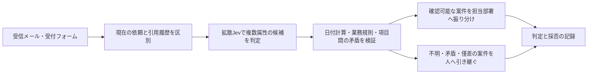

# 拡散Jevの応用先から考える、実務上の課題

2026年10月25日。最終 `runs/jev_infill` を追加で24回呼び出した。19件の業務想定入力と、その結果を受けた5件の切り分けである。前回同様、今回書いた架空の業務文で、顧客データやベンチマークではない。追加学習も実際の返金・通知・チケット更新もしていない。

## どこへ応用するモデルとして見るか

型付きの問いをまとめて判定する性質から、今回は**問い合わせ受付から担当者への引き継ぎまでの判定部品**を応用先に置いた。具体的には、受信メールから複数の属性を拾う、担当部署と優先度を提案する、返品受付に必要な情報の不足を見つける、といった使い方である。

ここでは分類が一つ当たればよいわけではない。「過去の障害を現在も発生中とする」と不要な緊急対応になり、「返品期限を誤る」と受付方針を間違える。「請求と配送の両方を頼まれたのに一方へしか回さない」と依頼が取り残される。単発の正解率より、**その出力で次の工程がどう動くか**を中心に試した。

今の手応えは、担当者に候補を提示する用途から始めたい、というもの。前回の素直な9件では妥当な判定が返ったが、今回の条件・履歴を含む入力では、業務上そのまま採用できない判断が見つかった。

## 実際に困った場面

| 応用先での入力 | 最終拡散Jevの実際の返答 | 次の工程で起こる問題 |
| --- | --- | --- |
| 「昨日は完全停止していたが、今朝復旧し、現在は全員使える」 | 現在も全停止：true 77.7%、至急83.9% | 解決済みの障害で緊急対応を起こす |
| 30日以内なら返品可能という架空規則。今日10/25、購入9/24、未開封 | 返品可能96.1%、承認用の受付を準備 | 実際には31日経過しており、期限外の受付を進める |
| 購入10/10、開封済み、検査で初期不良確認済み。規則には初期不良なら開封条件を免除すると明記 | 返品不可70.5%、規則による拒否を提案 | 明記した例外条件を適用せず、受付可能な案件を拒む |
| 「先月の二重請求と返金は解決済み。今回の依頼は配送先の変更」 | 一般窓口59.7%、二重請求あり75.5% | 現在の配送依頼を正しく引き継げず、古い事実も混ざる |
| 配送状況の確認と二重請求の返金を同時に依頼 | 配送担当55.1%、返金あり93.2%、二重請求あり98.0% | 単一担当の候補しかないので、請求側の依頼を落としうる |
| 「二重請求なら返金してほしいが、明細未確認で分からない」 | 二重請求あり67.9% | 条件付きの可能性を、確認済み事実として扱いうる |
| 16個の長い業務フィールド名をそのまま回答キーに使用 | CUDAの範囲外アクセスエラー | 1件の入力がワーカーのGPUコンテキストを壊しうる |

確率はAPIが採用するfirstの候補内確率。「二重請求を報告しているか」のような問い自体に時点や確認状況の曖昧さがある例もあり、すべてをモデル単独の失敗とは扱わない。実務で必要な概念を、入力と質問の設計が十分に表せていない問題も含む。

### 少し入力を変えて切り分けたこと

31日期限外の例へ、外部で計算した `Verified elapsed days since purchase: 31 days` を追記すると、返品不可97.2%へ変わった。日付だけからの計算と、既知の経過日数を使う判断では挙動が違った。1件の比較なので原因の断定はできないが、日付計算をプログラムへ出す実装方針は有力だと感じた。

復旧済み障害を英語へ直しても、現在全停止true 83.5%、至急92.8%と誤った。初期不良の開封免除も、英語へ直してなお返品不可80.7%。この2件は日本語だけの問題ではなさそうで、日本語の追加学習だけで解決する課題としては扱わない。

過去メールの例で「今回の未解決の依頼だけを対象にする」と追記し、二重請求の問いにも「解決済みの引用を除く」と明示すると、二重請求false 85.2%になった。ただし担当はまだ一般窓口57.4%で、配送担当へは戻らなかった。質問を明確にすると一部は改善するが、引き継ぎ全体の正しさは別に検証する必要がある。

### うまくいった条件もある

「二重請求ではない、返金不要、請求書の宛名変更だけ」という否定は拾えた。購入日不明・証拠なしの返品は「不明93.8%・証拠を求めて人が確認95.8%」を選んだ。「請求は当日期限でも通常扱い」という業務ルールの変更も反映できた。規則・問い・候補をすべて日本語にした単純な二重請求も、担当・至急・返金ありを妥当に返した。

したがって、規則や日本語が一律に扱えないという結果ではない。時点、例外、確認状態が絡んだときの挙動が気になる。

## 優先して取り組みたい課題

| 優先度 | 具体的に作るもの・変えるもの | 応用先で確認したい条件 |
| --- | --- | --- |
| P0 | **事実の判定と社内規則の適用を分ける。** 日付差・期限・承認条件はコードで計算し、モデルには本文の属性候補を出させる。根拠が不足・矛盾する案件は保留へ回す | 30日と31日で受付が正しく分かれ、開封免除の例外も決定的に適用される。高いモデル確率でも規則違反を通さない |
| P0 | **API入口で長さを検証する。** 外部の長い項目名を内部の短いIDへ対応付け、回答テンプレート長と全slotが128枠内かをCPU側で確認する。長い要求は分割または明確なエラーにする | 16問でも名前の長さでGPUエラーにならない。無効な要求の次にも正常な要求を処理できる |
| P1 | **現在・履歴・引用・条件を入力上で区別する。** 現在の本文と引用履歴を分け、質問にも対象時点・誰の主張か・確認済みかを明記する | 復旧済み障害でページングしない。未確認の二重請求を確定フラグへ変換しない |
| P1 | **保留と複数担当を型に入れる。** 事実が不明な問いはtrue/falseの代わりにChoice（確認済み／否定／不明）を使う。担当別のNoulや複数依頼の分割を使い、単一担当へ押し込まない | 請求と配送の両方が必要な依頼が、両方へ引き継がれる。不明をfalseと同じ扱いにしない |
| P1 | **業務ごとの保留基準と再現性を調べる。** 候補内確率に加え、同点・候補間の僅差・ルールとの矛盾を保留条件にする。質問順・候補順・乱数の影響を個別に切り分ける | 同じ意味の問い合わせが、画面の候補順や再送で違う優先度にならないか確認する |
| P2 | **常駐運用と監査記録を整える。** チェックポイント、業務ルール版、質問スキーマ版、入力参照、判定分布、最終採否を残す。起動・初回・通常応答を分けて測る | 誤振り分けの原因を後から追え、ルール変更時に影響範囲を確認できる |

今回の長いIDの8問は回答テンプレート105トークン・最後のslot位置102で動作したが、16問では209トークン・位置206となり128を超えた。「16問までなら安全」という問数だけの制限では足りない。IDを短くした8問ではエラーは起きなかったものの、明示されたtodayを問う2つの項目はfalseのままで、長さ対策が判断品質まで解決するわけではなかった。

また、同じ二重請求依頼を3回送ると、至急の確率は49.5%（通常と同点）・55.8%・55.6%だった。回答は至急のままだが、同点時は実装上、候補列挙順で最大値を選ぶ。質問順と候補順を両方逆転した別呼び出しでは通常76.4%になった。乱数条件も異なるため順序だけの効果とは断定できないが、運用前に切り分けたい不安定さである。

## 組み込み先として考えた処理の流れ

返金の実行や最終承認までを今回の試用で任せられるとは感じなかった。一方で、単純な依頼の複数属性を短時間で提示する働きは残っている。まず受付担当者の補助として使い、どの案件を保留へ回すべきかを実際の業務ログで見たい。

画像付き受付へ広げるなら、破損写真・明細・配送票の内容と文章の主張の照合が応用候補になる。ただし今回はその実務入力を試しておらず、ベンチマークの写真・磁石の成功例から、返品写真の判断まで使えるとは推定しない。

## 画像系の応用への追試

続けて、画面操作の前段判定と図版による点検を17回試した。エラー・成功・赤ランプなどの表示に反応したが、観察と操作選択の矛盾、欠落・抜け・遮蔽の見落としが出た。[画面・図版の実際の入力と出力](Diffusion-Jev_visual_practical.md)を参照。実設備写真の点検は未試用である。

## 原記録

- [追加19件の入力](../examples/practical_followup_requests.jsonl) と [実際の出力](practical_followup_20261025.jsonl)：18件が返答、最後の長いID・16問で1件エラー。
- [切り分け5件の入力](../examples/practical_followup_diagnostics.jsonl) と [実際の出力](practical_followup_diagnostics_20261025.jsonl)：5件とも返答。
- 実行器は [try_practical.py](../scripts/try_practical.py)。モデルとサンプラーは変更せず、最終モデルのfirst読み出しを利用。記載した確率は候補集合内で正規化した値であり、実業務の正解率を直接表すものではない。

追加19件の読み込みは27.1秒、切り分け5件では23.1秒。前回は153.7秒だったため、起動時間も環境・キャッシュ状態を含めてばらつく。今回の初回依頼は約1.50秒、その後の通常依頼は約0.32〜0.60秒だった。少数の逐次呼び出しであり、同時利用やサービスとしての応答保証は確認していない。
