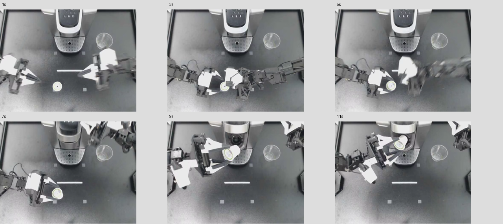

# 実ロボット動画で拡散Jevを使ってみる

2026年10月25日。最終拡散Jev `runs/jev_infill` と最終AR `runs/ar_sft_v5` を、RTX 4060 Ti（16GB）で各6条件、計12回呼び出した。追加学習なし。ベンチマークのスコア測定ではなく、フィジカルAIの教師データ候補を作れるかを見る手動試用である。

**評価は限定的なポジティブと、実用上はネガティブ。動画入力から複数時刻の構造化出力まで通り、正順では机→把持→機械付近という流れをある程度読めた。一方、逆再生の方向を両モデルが誤り、静止画だけでも過去の状態を回答した。そのまま教師ラベルとして採用できる品質とは確認できない。今回、拡散の速度優位も確認できなかった。**

## 実際に渡した動画

公開データセット [lerobot/aloha_static_coffee](https://huggingface.co/datasets/lerobot/aloha_static_coffee) の episode 0、頭上カメラを使用。元動画は22秒・50fps・640×480。先頭12.8秒を10fps・128フレームのH.264動画にし、同じフレーム列を逆順にした対照も作った。出典の固定revision・元パスは [provenance.json](video_practical/source/provenance.json)、加工条件は [preparation.json](video_practical/preparation.json) に保存。

対象は下側中央にある小さな淡色のコーヒーカプセル。右側の透明なカップとは区別する。カプセルを机から把持器で運び、コーヒーマシンへ入れる場面である。音声・ロボットの関節状態・行動ラベルは渡していない。

[実際の正順MP4](video_practical/clips/coffee_forward.mp4) / [実際の逆順MP4](video_practical/clips/coffee_reverse.mp4)

モデルにはこの一覧画像を渡したのではなく、MP4を動画プロセッサで処理して渡した。実測では各動画から25フレームを抽出し、0.0〜12.7秒を参照した。入力fpsの設定は2で、丸めを含む実際の抽出時刻は生ログに記録。時刻付きの動画トークンと `video_grid_thw=[[13,30,40]]` を確認した。時間方向のパッチ化による補完を含むため、グリッドの13を13枚の入力画像と解釈しない。

## 何を聞いたか

共通の英文で対象物と時刻の基準を指定し、各時刻の位置と全体の移動方向をChoiceの穴に埋めさせた。静止画の場合には、過去の時刻や動作方向を推測しないよう明記した。質問全文は [入力JSONL](../examples/video_practical_requests.jsonl)。

位置の選択肢：

| 値 | 意味 |
| --- | --- |
| 1 | 机の上にあり、把持されているようには見えない |
| 2 | 把持器に保持され、機械の開口部から離れている |
| 3 | 機械の開口部付近または内部 |
| 4 | 見えない・判断できない |

移動方向 `order` の選択肢は、1＝机→機械、2＝機械→机、3＝動きが見えない、4＝判断できない。

6時刻版は1・3・5・7・9・11秒、3時刻版は1・7・11秒、12時刻版は0.5秒から11.5秒まで1秒刻み。逆順版の時刻は逆順動画の先頭から数える。静止画対照は正順動画の最終フレーム1枚だけを渡した。

## 実際の出力

以下はAPIと同じ初回読み出し（first）の最大確率候補。数字は上記の選択肢であり、人手の正解ラベルではない。

| 入力 | 拡散Jevの位置ラベル列 | ARの位置ラベル列 | 方向：拡散 / AR |
| --- | --- | --- | --- |
| 正順・6時刻 | 1 → 2 → 2 → 2 → 3 → 3 | 1 → 2 → 2 → 2 → 2 → 2 | 1 / 1 |
| 逆順・6時刻 | 2 → 3 → 2 → 2 → 1 → 1 | 2 → 3 → 2 → 2 → 1 → 1 | 1 / 1 |
| 最終静止画・6時刻 | 1 → 2 → 3 → 3 → 3 → 3 | 1 → 1 → 1 → 1 → 1 → 1 | 1 / 3 |
| 正順・3時刻 | 1 → 3 → 3 | 1 → 2 → 3 | 1 / 1 |
| 正順・12時刻 | 1 → 1 → 2 → 2 → 2 → 2 → 2 → 3 → 3 → 3 → 3 → 1 | 1 → 1 → 1 → 1 → 1 → 1 → 1 → 1 → 1 → 1 → 1 → 1 | 1 / 1 |
| 正順・6時刻／画質設定変更の試行 | 1 → 2 → 2 → 2 → 3 → 3 | 1 → 2 → 2 → 2 → 2 → 2 | 1 / 1 |

最後の条件は `max_video_tokens` を768→1536へ変更した試行。ただし実際の動画グリッドと入力サイズは変わらなかった。**高解像度での効果を確認した試験として扱わず、同じ画像サイズで再実行した参考値とする。**

### 正順では何が読めたか

拡散の6時刻版は `1,2,2,2,3,3`。目視では1秒に机の上、5〜7秒に把持器で運搬、9〜11秒に機械へ接近・挿入という大きな変化があり、この出力はおおむね対応している。ただし3秒は把持・持上げの境界、9秒は開口部付近の境界なので、独立した正解アノテーションなしに全問正解とはしない。ARは6時刻版で後半も2と答えた。

### 逆順にすると、時刻別の位置と全体の説明が矛盾する

両モデルの逆順出力は `2,3,2,2,1,1` と、後半が机の上へ変わった。それでも方向は両方とも **1＝机→機械**。拡散の方向候補内確率は88.5%。正順の99.1%より下がったが、逆順を判別できなかった。時刻別の入力に反応しても、作業の典型的な流れに全体判断が引っ張られる可能性がある。

逆再生は実際の正常作業ではなく、時間順序への依存を切り分ける人工的な対照。それでも方向の問題では機械側→机側という見える順序を判断してほしかった。

### 静止画だけでも時間列を埋めてしまう

最終静止画だけに対し、拡散は `1,2,3,3,3,3` と過去の動きを埋め、方向も机→機械（94.1%）とした。ARも各時刻をすべて1とし、方向は3＝動きが見えないとした。両方とも過去の各時刻を判断不能として返せていない。映像を十分に見たのか、作業常識で補ったのかを分けるために、この対照が必要だった。

### 質問数・反復で安定するわけではない

同じ7秒を拡散は6時刻版で2、3時刻版で3と答えた。質問のまとめ方でもラベルが変わる。12時刻版では最後の11.5秒を1＝机の上とした。

反復終了時（final）も保存した。正順6時刻版は first `1,2,2,2,3,3` に対し final `1,2,2,2,2,1`。11秒を机の上へ変更しており、反復しただけで改善するとは言えない。現在のAPIはfirstを返すため、報告の主結果もfirstで揃えた。finalへの単純な切替を解決策にはしない。

## 実測時間

動画の読み込み・前処理から判定終了までの壁時計時間。モデルの起動時間は除外し、動画の読み込みは含める。初回はGPU等のウォームアップ差がある。各条件1回のみで、速度ベンチマークではない。

| 条件 | 拡散Jev 合計秒 | AR 合計秒 | 拡散のencode / denoise秒 |
| --- | ---: | ---: | ---: |
| 正順・6時刻 | 5.20 | 3.89 | 3.10 / 0.99 |
| 逆順・6時刻 | 4.07 | 3.64 | 2.11 / 0.86 |
| 最終静止画・6時刻 | 1.05 | 0.77 | 0.35 / 0.69 |
| 正順・3時刻 | 3.32 | 3.02 | 2.01 / 0.53 |
| 正順・12時刻 | 5.02 | 4.08 | 2.28 / 1.93 |
| 正順・6時刻／画質設定変更の試行 | 3.63 | 3.34 | 2.10 / 0.76 |

今回の全条件で拡散の合計時間はARを上回った。動画の前処理・視覚特徴・文脈エンコードの負担に加え、出力側も質問数で処理量が変わる。並列の穴埋めが可能なことから、そのまま高速化を結論づけられない。ARにも同じ全編動画を渡し、視覚入力のprefillを1回にしてKVキャッシュを利用した。AR用読み出しは、既存のテキストAR実装との2問比較で候補確率の最大差0.0を確認したが、動画AR経路の独立した実装間照合は未実施。

## 実務への含意と次の課題

フィジカルAIのアノテーションでは、「一応JSONになった」ことより、観測できない時刻を埋めないこと、時間順序を守ること、把持や解放の境界を再現できることが重要になる。

- **元の視覚能力と追加学習を切り分ける。** 今回は最終2モデルのみ。元バックボーンの同一入力との比較、時間窓のラベル列に対する追加学習、逆順・静止画・遮蔽を含む不明判定の学習が次の検証候補。今回だけで学習不足が原因とは断定しない。
- **ラベルを定義する。** 「開口部付近」の距離、「把持」の見える基準、接触と保持、作業成功と物体位置を分ける。今回は対象物を文章で指定しただけで、参照画像・物体IDによる追跡や接触センサとの照合はしていない。
- **アノテーションの受入条件を作る。** 独立した人手ラベル、境界の許容誤差、保留すべき場面を定め、修正時間まで測る。単一動画から別作業・失敗動作・落下の性能へ一般化しない。
- **反復の価値を検証する。** first/finalの整合・誤りと、質問数による変化を比較する。速度は同等品質・複数回・同じ読み出し方で再測定する。

日本語・トークナイザと汎用自由文SD·RLは、既存の[今後の課題](Diffusion-Jev_future_work.md)に残す。今回確認したのは、短い実動画1本を使ったオフラインの候補ラベル生成まで。ロボットの制御、リアルタイム処理、教師データとしての有効性は確認していない。

## 再現用記録

- [動画準備スクリプト](../scripts/prepare_video_practical.py)
- [最終2モデルの動画試用スクリプト](../scripts/try_video_practical.py)
- [拡散の生出力JSONL](../logs/video_practical_diffusion_20261025.jsonl) / [ARの生出力JSONL](../logs/video_practical_ar_20261025.jsonl)
- [初回のデコーダ互換性確認ログ](../logs/video_practical_decoder_smoke_20261025.jsonl)

最初はtorchcodec未導入とtorchvision側の動画API削除により、動画デコード前に失敗した。この失敗はモデルの判断結果に含めていない。試用スクリプト内でPyAVによりMP4をデコードし、fps・フレーム情報を保持して動画プロセッサに渡して再実行した。モデル重み・サンプラー・通常APIは変更していない。

## 発表スライドへの反映

既存のGoogle Slidesへ動画試用を6枚追加し、32〜37枚目に配置した（全45枚）。正順プレビューと質問、時刻別画像と実出力、逆再生、静止画対照、first/finalと実測時間、ポジティブ・ネガティブのまとめ。今後の課題の「未実施」という表現を最小試用後の内容へ更新し、日本語・トークナイザと自由文SD·RLは保持した。全45枚のPDF表示を確認。

### 作業フェーズの詳細定義で再試用

位置ラベルを接近・把持・把持移動・開ける・設置・閉める等の9択へ変更し、同じ選択肢で名称のみ／詳細定義を比較した。最終拡散とAR各7条件、計14回。拡散の正順は6区間中1区間、ARは3区間の最大候補が変わったが、逆順方向の誤判定と静止画での不明判定は解決しなかった。定義は出力に影響するが、文章を詳しくするだけで十分とは確認できない。[定義・比較条件・実出力](Diffusion-Jev_video_phase_definitions.md)。前回の位置ラベル試用とは課題が違うため、正解率の改善としては比較しない。

最新のスライドでは動画の本編を28〜35枚目へ整理し、35枚目を動画処理の結果まとめとした。順序・保留・速度の課題と、作業ラベル自動作成の未達を明記。反復・全22秒・全体時間の詳細は補足52〜54枚目。
