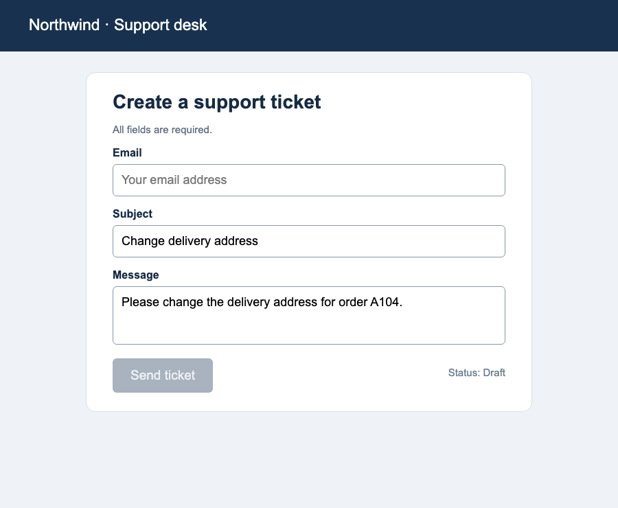
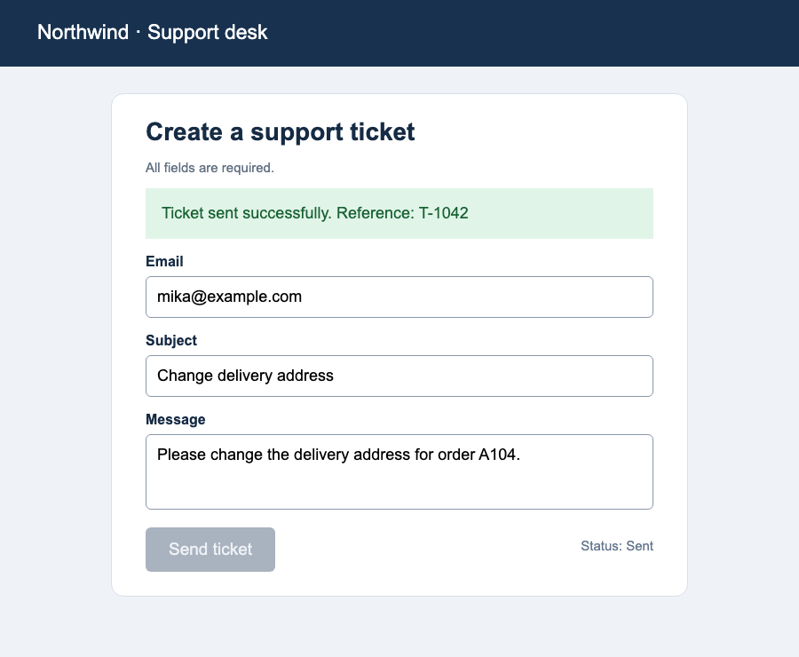
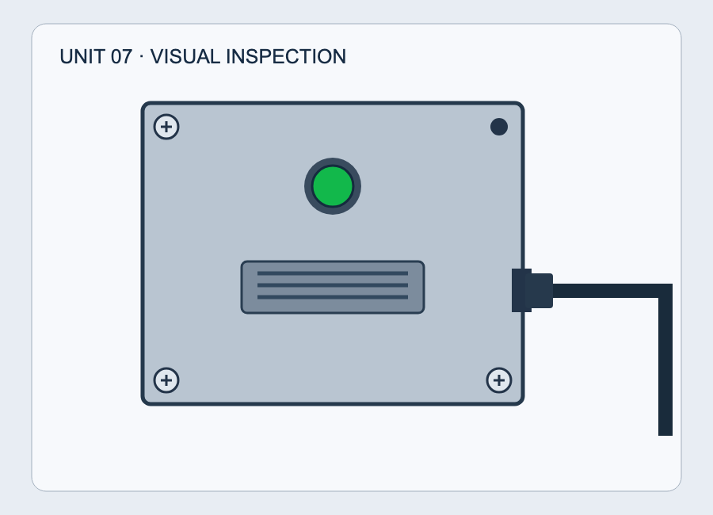
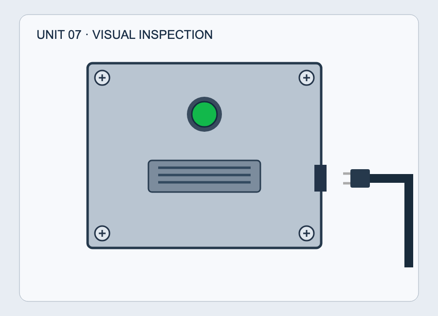
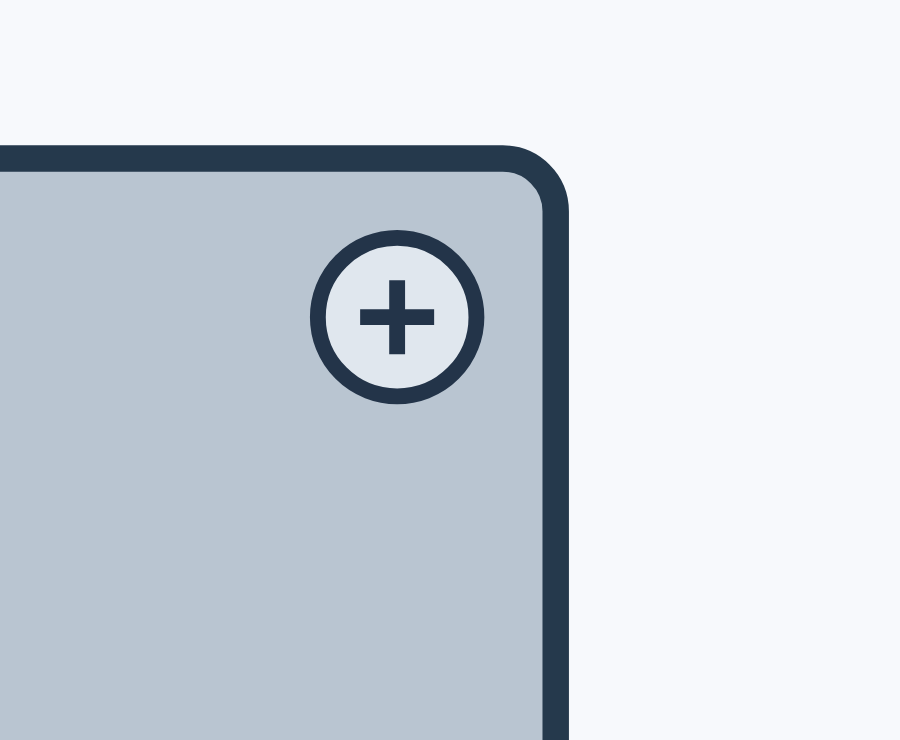
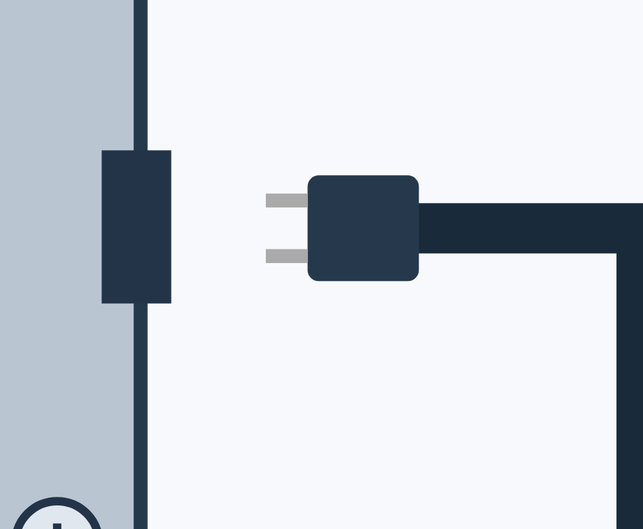

# 拡散Jevを画面操作と画像付き点検で使ってみる

2026年10月25日。最終 `runs/jev_infill` をRTX 4060 Ti（16GB）上で17回呼び出した。今回は問い合わせ文から離れ、画面操作の前段判定と、図版を使った点検支援へ応用してみた。ベンチマークや追加学習は使っていない。

入力は今回作ったもの。フォームはHTMLをChromiumで描画したスクリーンショット、点検は状態を指定できるSVG図版を同じブラウザで描画した画像である。**現場の設備写真を使った試用ではない。** モデルには画像と共通の判断規則を渡し、DOMや正解データは渡していない。実際のクリック・送信・設備操作も行っていない。

## 画面操作の前段判定

応用先は、受付フォームを操作するエージェントの判断部品。メール欄の状態、エラー表示、送信ボタンの状態、成功確認、次の操作の5項目をまとめて聞いた。画面状態を読むことと、その観察から次の操作を選ぶことは別に確認した。

規則は、必須欄が埋まり・エラーがなく・ボタンが有効な場合だけ送信、処理中なら待つ、成功表示なら終了、必要なコントロールが見えなければ情報を求める、というもの。6種類の画面と画像なしの対照を試した。

| 画面 | 実際に読めたこと・取り違えたこと | モデルが選んだ次の操作 |
| --- | --- | --- |
| メール未入力・ボタン無効 | 未入力90.7%、無効94.0%と正しく判定 | **送信47.4%**。入力を埋める41.8%より上で、観察結果と矛盾 |
| 必須欄入力済み・ボタン有効 | 入力済み99.2%、有効93.4% | 送信82.5%。この画面では妥当 |
| メール形式エラー・ボタン無効 | エラーあり99.4%、無効98.0% | エラー修正67.5%。妥当 |
| Sending…表示・ボタン無効 | ボタンを有効68.5%と誤判定 | 待つ62.9%。次の操作自体は妥当 |
| 送信成功の確認表示 | 成功確認あり99.5% | 完了して終了97.6%。妥当 |
| ボタンを表示していない画面 | 見えていないボタンを有効48.3%と判定 | **送信78.4%**。必要な操作対象を確認できていない |
| 画像を渡さない対照 | メールは空64.0%、ボタンは有効66.2%と推測 | **送信51.4%**。見えないことを理由に保留できなかった |

最後の画像なし対照では、そもそも見える情報がないので保留してほしかった。これは、画像が欠けた際にモデル任せで継続すると、入力の欠損を検知せず行動候補が出る、という組み込み上の問題でもある。

この画像に対して「未入力・無効」と読めたのに「次は送信」と返したことが、今回の画面試用で最も気になった点。候補内確率が高くなかったとしても、APIの最大確率候補をそのままクリックへつなぐと、この矛盾は通ってしまう。

成功表示の読み取りと終了判断はできた。したがって画面を全く読めていないわけではない。ただし、静止画の「ボタンが有効そうに見える」と、DOM上で実際に有効でクリック可能なことは別であり、操作の成功も今回確認していない。

## 図版を使った点検支援

応用先は、点検担当者がパネルのボルト・配線・表示灯を確認する際の補助。正常、右上ボルト欠落、配線抜け、右下が覆われている、赤ランプの5状態を作った。4本すべて確認でき、配線が接続され、緑ランプなら合格。欠落・抜け・赤は手直し、隠れて判断不能なら人が確認、という規則を入力に明記した。

| 図版の状態 | 最終拡散Jevの実際の観察 | 次の判定 |
| --- | --- | --- |
| 正常 | ボルト4本99.6%、緑99.9%、配線接続99.7% | 合格97.0% |
| 右上のボルト欠落 | **4本ある98.6%**と誤判定 | **合格97.2%** |
| 配線が抜けている | **接続済み99.7%**と誤判定 | **合格97.5%** |
| 右下をカバーで隠した | **4本確認できる98.2%**と誤判定 | **合格94.3%** |
| ランプが赤 | 赤90.7%と認識 | 手直し80.6% |
| 画像なしの対照 | 緑92.4%、配線接続92.9%と根拠なく推測 | 手直し49.7%。不明による人への確認を選ばず |

大きな赤／緑の違いには反応したが、局所的な部品の違いや接続関係は見落とした。合格の確率も高かったため、低確信度だけを人へ回す運用では、この例の見落としを拾えない。

### 局所を大きくすれば改善するか

同じSVGの表示領域を変えて、ボルトのある角と配線接続部だけを大きく描画した4画像を追加で渡した。質問も、その局所の1項目だけに絞った。

| 拡大画像 | 実際の返答 |
| --- | --- |
| 十字のねじ頭がある角 | 空の穴84.97%と誤判定 |
| ねじがなく暗い穴だけの角 | 空の穴86.29%。こちらは妥当 |
| 接続済みの配線 | 接続42.23%と未接続42.23%が同点。候補順で接続を選択 |
| ソケットとプラグに隙間がある配線 | 接続64.33%と誤判定 |

今回の条件では、単に拡大して質問を減らすだけでは安定しなかった。ただし図柄、質問文、候補の表現、学習データとの違いも影響しうる。少数の図版から現場写真全般の性能や、失敗の原因を断定はしない。

## 応用先から見た課題

**画面操作では、まず表示状態の整理と担当者への提案に使いたい。** エラーや成功表示を読めた点は使い道がある。一方、実行前に「未入力なら送信しない」「処理中は再送しない」「操作対象がなければ止まる」という制約をコードで確認する必要がある。DOMやアクセシビリティ情報を取得できる環境では、それも合わせて使う。画像が添付されていない要求は、モデルに渡す前に入力不備として扱う。

**点検の合格判定は、今の試用結果では任せにくい。** 欠落や抜けを高い確率で見落とした。次に行うなら、現場の実物写真を正常・異常・遮蔽の組で集め、部品位置の検出や領域ごとの確認と組み合わせる。対象が本当に見えているかを記録し、分からないときの保留を含めて検証したい。現在の図版試用は、その前の初歩的な確認である。

共通する課題は、**画像から得た各項目と、次の判断の整合性**。全項目を一度に返せることは便利だが、相互に矛盾する出力を自動的に防げることは意味しない。また、候補に「不明」を置くだけでは、見えない場面で不明が選ばれる保証もなかった。

## 試用結果の評価

**表示状態の読み取りにはポジティブな結果があった一方、自動操作・点検合格の判断を任せる用途にはネガティブだった。** エラー・成功表示・赤いランプは読めたが、観察と次の操作が矛盾し、欠落・配線抜け・遮蔽を高い確率で見落とした。現状は担当者への判断候補の提示から始め、自動実行前の検証と見えないときの保留を設計したい。今回の自作画面・人工図版による定性的な評価であり、実運用品質を測った結果ではない。

日本語・SD·RLなど元からの課題も継続し、失敗の解釈は元の能力・追加学習・定義の問題へ分けて検証する。動画では時間窓ラベルをまとめて更新する構成を、フィジカルAIのアノテーションとして今後試す。[今後の研究課題](Diffusion-Jev_future_work.md)を参照。

## 実行条件と原記録

- 本試用：画面6画像＋画像なし1件、点検5画像＋画像なし1件、計13回。
- 局所拡大の切り分け：4画像・4回。すべて最終拡散Jevのみで、ARとの比較は今回行っていない。
- 最初の呼び出しは9.94秒、以後の画像付き呼び出しは約0.51〜0.85秒。画像なしは別条件なので速度比較の結論には使わない。読み込み158.5秒。局所試用の別プロセスは読み込み19.8秒、初回1.94秒、以後約0.52〜0.62秒。
- 答え・確率はfirst、所要時間は反復停止まで。各入力1回の呼び出しで、安定性や実業務での正解率は測っていない。

[本試用の入力](../examples/visual_practical_requests.jsonl)・[生の出力](visual_practical/results_20261025.jsonl)、[局所試用の入力](../examples/visual_practical_focus_requests.jsonl)・[生の出力](visual_practical/focus_results_20261025.jsonl)を保存した。[図版・画面の元ソース](visual_practical/html/)と[画像](visual_practical/images/)も残している。

フォームのメール欄の候補は「メールアドレスが入っている／空／見えない」という表現だったため、不正な文字列 `mika@` の入力状態には曖昧さがある。そこはメール形式の妥当性を評価せず、独立したエラー表示・ボタン・次の操作の回答を見る。次回は「非空文字列があるか」と「有効な形式か」を質問でも分ける。

実務試用の掲載例ごとの処理時間をスライド25枚目に追加。モデル起動時間は除外し、未入力画面の初回9.936秒は参考値として通常時と分離した。

最新のスライドでは実務の処理時間が19枚目、結果のまとめが20枚目。まとめは「読解の補助に手応え、自動実行は任せられない」と明記した。
